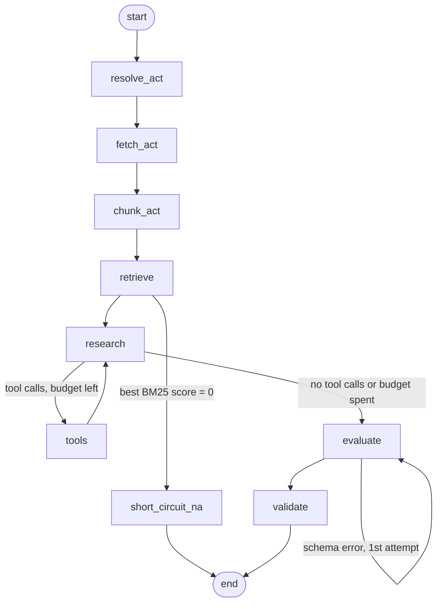

# legal-checker

A proof of concept of an **AI Legal & Compliance Checker** for Polish company documents. It takes a fragment of a document (e.g. a clause from terms of service) and a hint naming a legal act, fetches the act's **current wording** from the public [Sejm ELI API](https://api.sejm.gov.pl/eli), finds the relevant provisions and asks an LLM whether the fragment complies with them. Deterministic code checks and completes the LLM's answer before it is returned.

The result is one of four statuses, with a confidence, the provision it rests on, a verbatim quote from the document, a short rationale and an optional suggested fix:

| Status | Meaning |
|---|---|
| `ZGODNY` | compliant |
| `CZĘŚCIOWO ZGODNY` | partially compliant |
| `NIEZGODNY` | non-compliant |
| `NIE DOTYCZY / BRAK PODSTAW DO OCENY` | the act does not apply / no basis for an assessment |

> **Not legal advice.** This is a prototype. Its assessments can be wrong and must not replace review by a lawyer.

The CLI, prompts and results are in Polish. The implementation spec is [`specs/SPEC.md`](specs/SPEC.md) (in Polish) and the design decisions are in [`docs/adr/`](docs/adr/).

## Requirements

* Python 3.12+
* [uv](https://docs.astral.sh/uv/)
* An LLM: an API key for a hosted provider (Anthropic, OpenAI, Google, Groq) or a local model through [Ollama](https://ollama.com/)
* Network access to `api.sejm.gov.pl` (not needed for the default test suite)

## Quick start

```sh
# 1. Install the project with the integration package of your LLM provider
uv sync --extra anthropic        # or: openai, google, groq, ollama

# 2. Configure the model and its API key
cp .env.example .env
# edit .env: LLM_MODEL=anthropic:claude-sonnet-5-5 and ANTHROPIC_API_KEY=...

# 3. Check a fragment
uv run legal-checker \
  --text "Klient może odstąpić od umowy zawartej na odległość w terminie 7 dni od dnia otrzymania towaru." \
  --hint "Dz.U. z 2014 r. poz. 827"
```

### Running on a local model (Ollama)

No API key is needed. The Ollama server must run with a context window that fits the whole request (about 13K tokens):

```sh
uv sync --extra ollama
ollama pull gpt-oss:20b
OLLAMA_CONTEXT_LENGTH=32768 ollama serve
# in .env: LLM_MODEL=ollama:gpt-oss:20b
```

## Usage

```text
legal-checker (--text TEXT | --file PATH) --hint HINT [--verbose]
legal-checker --show-graph
```

| Option | Description |
|---|---|
| `--text` | The document fragment to assess |
| `--file` | A UTF-8 file with the fragment; `-` reads from stdin |
| `--hint` | The act to check against, in any of these forms (see below) |
| `--verbose` | Stream each step of the graph to stderr (act resolved, BM25 hits, tool calls, assessment) |
| `--show-graph` | Print the graph as a Mermaid diagram and exit; needs no API key and makes no requests |

The act hint can be:

* an ELI key: `DU/2014/827`
* an ELI link: `https://eli.gov.pl/eli/DU/2014/827/ogl` or `https://api.sejm.gov.pl/eli/acts/DU/2014/827`
* a publication reference: `Dz.U. z 2014 r. poz. 827`, `Dz. U. 2014 poz. 827`, `M.P. 2023 poz. 100`
* a title, looked up with the ELI search: `ustawa o prawach konsumenta`

The CLI prints the `ComplianceResult` as JSON on stdout, followed by a report for a human: the assessment, the legal basis, the provisions the agent saw (`consulted_units`), the tool calls it made and any warnings. Exit code `0` means an assessment was produced (whatever its status); `1` means an error, e.g. the act could not be resolved or fetched, or the model kept violating the output schema.

The JSON has this shape:

```jsonc
{
  "status": "NIEZGODNY",
  "confidence": 0.9,
  "document_excerpt": "…a verbatim quote from the fragment…",
  "legal_basis": {
    "act_title": "Ustawa z dnia 30 maja 2014 r. o prawach konsumenta",
    "eli": "DU/2014/827",
    "provision": "art. 27",
    "as_of_date": "2026-11-23",          // the day the act was fetched
    "source_url": "https://api.sejm.gov.pl/eli/acts/DU/2014/827/text/U/D20140827Lj.pdf"
  },
  "rationale": "2–5 sentences in Polish",
  "suggested_fix": "…or null",
  "consulted_units": ["DU/2014/827:art.27", "…"],
  "warnings": []
}
```

## Configuration

Settings come from environment variables, and from a `.env` file in the working directory if present (see [`.env.example`](.env.example) and [`config.py`](src/legal_checker/config.py)).

| Variable | Default | Description |
|---|---|---|
| `LLM_MODEL` | `anthropic:claude-sonnet-5-5` | `provider:model` string for LangChain's `init_chat_model` (`anthropic:`, `openai:`, `google_genai:`, `groq:`, `ollama:`). Switching provider is a `.env` change, given its extra is installed |
| `ANTHROPIC_API_KEY`, `OPENAI_API_KEY`, `GOOGLE_API_KEY`, `GROQ_API_KEY` | — | The provider's API key, read by its LangChain integration |
| `ELI_API_BASE_URL` | `https://api.sejm.gov.pl/eli` | Base URL of the ELI API |
| `BM25_TOP_K` | `12` | Number of BM25 candidates given to the agent |
| `AGENT_MAX_TOOL_CALLS` | `4` | Tool-call budget of the research agent |
| `GRAPH_RECURSION_LIMIT` | `20` | LangGraph recursion limit for one request |
| `CACHE_DIR` | `.cache` | Local cache of fetched acts and extracted text |
| `LANGSMITH_TRACING`, `LANGSMITH_API_KEY` | — | Optional: trace each run in LangSmith, with no code changes |

## Architecture

### Who does what

The design keeps the LLM to the two decisions that need judgement and leaves everything else to deterministic code:

* **Deterministic Python:** resolving the hint to an ELI key, talking to the ELI API, choosing the current text, PDF/HTML extraction and clean-up, splitting the act by legal structure, BM25 search, the agent's tools and validating the LLM's output.
* **Orchestration (LangGraph):** an explicit `StateGraph` with a fixed order of steps, conditional edges and hard limits. The LLM never decides which deterministic step runs next.
* **LLM (via LangChain):**
  * *research*: decide whether the BM25 candidates are enough, or fetch more provisions with two read-only tools;
  * *evaluate*: assess the fragment against the provisions it was given, with the answer forced into a JSON Schema.

### The graph



| Node | Kind | What it does |
|---|---|---|
| `resolve_act` | code | Turns the hint into an ELI key: ELI key or link → publication reference → title search |
| `fetch_act` | code | Fetches the act's metadata and its current text, through the local cache |
| `chunk_act` | code | Extracts and cleans the text, then splits it into `LegalUnit`s (articles, or paragraphs of long articles) with their place in the act's hierarchy |
| `retrieve` | code | BM25 search over the units for the fragment; also pulls in articles the top hits refer to |
| `short_circuit_na` | code | No lexical overlap at all: returns `NIE DOTYCZY` without calling the LLM |
| `research` | LLM + tools | May call `search_provisions(query)` or `get_provision(article, paragraph)` to fetch more provisions from the index |
| `tools` | code | Runs the tool calls within the `AGENT_MAX_TOOL_CALLS` budget |
| `evaluate` | LLM | Structured-output assessment; one retry with the error attached if the output breaks the schema |
| `validate` | code | Post-validation and assembly of the final result |

`research` and `evaluate` are separate LLM calls: one model has the tools bound, the other uses `with_structured_output`. This keeps the prompts simple and avoids provider limits on mixing tool calls with a forced JSON Schema. Run `uv run legal-checker --show-graph` for the diagram generated from the compiled graph.

### Guardrails

* **The agent sees only the act.** Its tools are read-only views of the request's in-memory BM25 index. They have no network access and no side effects; fetching the act is a graph node, not a tool.
* **Code, not the LLM, decides what the agent saw.** `consulted_units` is computed as the BM25 candidates plus everything the tools returned. If the provision the LLM cites is not among them, the result gets a warning.
* **Quotes are verified.** If `document_excerpt` is not found verbatim in the input (after normalising whitespace), the result gets a warning and a lower confidence.
* **Source metadata is injected by code.** `act_title`, `eli`, `source_url` and `as_of_date` never come from the LLM.
* **Uncertain applicability caps confidence.** When the model reports it cannot tell whether the act applies to the parties (e.g. B2B or B2C), confidence is capped at 0.7.
* **Hard limits** on tool calls, schema retries and graph recursion keep the cost of a request bounded.

### Current wording of the act

The ELI API's `text.html` holds the act as originally published, so it misses every later amendment. The checker prefers, in order: the act's unified text PDF (`U`, kept up to date by Kancelaria Sejmu), the newest official consolidated text, `text.html`, then `text.pdf`. Text extraction strips page headers and footers, rejoins hyphenated words, keeps wording that is in force today (`[…]`) and drops amendments not yet in force (`<…>`). See [ADR 0002](docs/adr/0002-current-act-text-source.md).

### Code map

```text
src/legal_checker/
├── cli.py              # CLI: arguments, JSON output, human-readable report
├── config.py           # Settings from the environment / .env
├── models.py           # Pydantic contracts: CheckRequest, LegalUnit, LlmEvaluationPayload, ComplianceResult
├── eli_resolver.py     # Act hint → ELI key (three paths)
├── eli_client.py       # ELI API client, choice of the current text, local cache
├── text_extractor.py   # PDF/HTML extraction and clean-up
├── legal_chunker.py    # Split by legal structure into LegalUnits
├── bm25_retriever.py   # Polish tokenizer and in-memory BM25 index
├── post_validator.py   # Deterministic checks and assembly of ComplianceResult
└── agent/
    ├── state.py        # GraphState
    ├── llm.py          # Research and evaluation models (init_chat_model)
    ├── prompts.py      # System prompts (Polish)
    ├── tools.py        # search_provisions, get_provision
    ├── nodes.py        # Graph nodes and routers
    └── graph.py        # Graph assembly, run(), check()
```

Everything runs in memory within one process: there is no database, vector store or embeddings, and no LangGraph checkpointer. The only state kept between runs is the file cache in `CACHE_DIR`.

### Using it from Python

```python
from legal_checker.agent.graph import check
from legal_checker.models import CheckRequest

result = check(CheckRequest(document_fragment="…", act_hint="DU/2014/827"))
print(result.status, result.confidence)
```

## Tests

```sh
uv run pytest            # offline suite: no network, no API key
uv run pytest -m live    # real ELI API and the LLM from LLM_MODEL
```

The default suite mocks HTTP with `respx` on the reserved host `eli-api.test` and runs the graph on fake chat models, so it checks routing, limits, retries and validation deterministically. Tests that call real services are marked `@pytest.mark.live` and are deselected by default.

[`tests/test_e2e_cases.py`](tests/test_e2e_cases.py) has six end-to-end cases against the consumer rights act (`DU/2014/827`): one per status, a borderline case where it is unclear whether the act applies to the parties, and the same case run with each hint format. Offline they verify the path through the graph; with `-m live` they check the assessment itself. Live cases are skipped when the configured provider's API key is missing (Ollama needs none). On Groq the request is cut down and rate-limited to fit the free tier's 8K tokens per minute.

CI ([`.github/workflows/ci.yml`](.github/workflows/ci.yml)) runs `uv sync --locked` and the offline suite on every push to `main` and every pull request.

## Scope and limitations

This is a PoC with deliberate simplifications ([SPEC section 1.3](specs/SPEC.md)):

* One fragment against one act per request, and the act must be named. Checking a whole document against acts the tool picks itself is left for a later version ([ADR 0001](docs/adr/0001-langgraph-stategraph-over-deep-agents.md) describes how).
* Only the law as it stands today; no assessments as of a past date.
* Retrieval is lexical (BM25 with a light Polish stemmer), so a fragment phrased very differently from the act can miss the relevant provisions.
* The unified text is an informational copy, not the legally binding publication; `source_url` points at the exact file used.

## Design decisions

* [ADR 0001: LangGraph `StateGraph` over Deep Agents](docs/adr/0001-langgraph-stategraph-over-deep-agents.md)
* [ADR 0002: Unified text PDF over HTML as the source of an act's current wording](docs/adr/0002-current-act-text-source.md)
